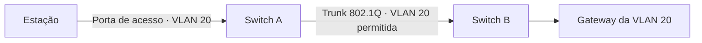

# VLAN na prática: por que a estação não consegue chegar ao gateway?

Um computador foi ligado ao novo switch. A interface tem link e o endereço IP está na faixa esperada, mas o gateway não responde. Antes de trocar cabo, alterar o firewall ou investigar DNS, vale localizar em que ponto a VLAN deixa de seguir pelo caminho esperado.

## Cenário fictício

A estação pertence à VLAN 20. Ela se conecta a uma porta de acesso no switch A. O gateway da VLAN está no switch B, que se comunica com o switch A por um trunk 802.1Q.

Uma porta de acesso associa o tráfego da estação à VLAN configurada. Um trunk pode transportar várias VLANs pelo mesmo enlace. Neste exemplo, a VLAN 20 segue marcada no trunk. Para isso, precisa estar ativa e ser encaminhada ao longo do caminho, com configuração compatível nas duas pontas.

## Onde olhar primeiro

1. **Estação e porta de acesso.** Confirme o estado da interface, a VLAN operacional da porta e se o switch aprende o MAC da estação na VLAN 20. Confira também endereço, máscara e gateway no cliente. Um IP na faixa esperada pode ter sido configurado manualmente ou obtido antes da mudança.
2. **Enlace entre switches.** Confira se o enlace opera como trunk e se a VLAN 20 está permitida e ativa nas duas pontas. Se estiver na lista mas o tráfego não passar, verifique também o estado de encaminhamento da VLAN. Ver a VLAN na lista de permissões é apenas uma parte da confirmação.
3. **Gateway local à VLAN.** Confira se a interface de camada 3 da VLAN 20 está operacional. Se a estação não consegue resolver por ARP o endereço do gateway IPv4, investigue primeiro a conectividade local. Se resolve o MAC e só o ping falha, confira se o ICMP está filtrado e use um teste permitido. Um ping isolado não comprova a causa.
4. **Comunicação com outra rede.** Quando o acesso ao gateway estiver confirmado, valide se existe rota e se as regras permitem o destino e a porta necessários. Uma VLAN separa tráfego de camada 2. O que pode atravessar entre redes depende do roteamento e das políticas aplicadas.

## Exercício de bancada

Neste cenário, o switch A aprende o MAC da estação na VLAN 20. O trunk está operacional, mas o switch B não tem a VLAN 20 na lista permitida. Qual é o primeiro ajuste de escopo mínimo que faria sentido avaliar?

**Resposta esperada.** Revisar a intenção do enlace e autorizar a VLAN 20 no caminho, se o desenho exigir que ela passe por ali. Após a correção autorizada, verificar novamente o encaminhamento, a resolução ARP do gateway e o acesso ao serviço esperado. Liberar todas as VLANs aumenta o alcance da mudança sem demonstrar sua necessidade.

Exemplo didático, sem vínculo com uma rede real. Os nomes dos menus e comandos variam com o equipamento e a versão.

[Referência: configuração de trunks 802.1Q em Cisco Catalyst](https://www.cisco.com/c/en/us/td/docs/switches/lan/c9000/lyr2-fwd/vlan/vlan-configuration-guide.pdf)
